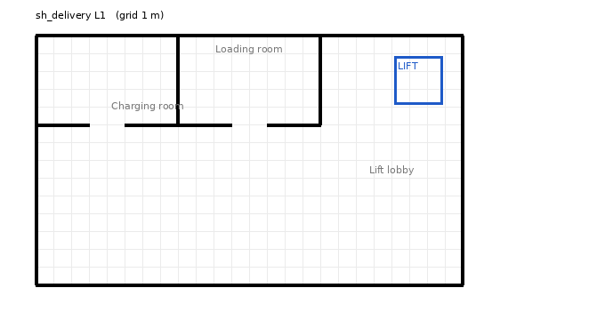
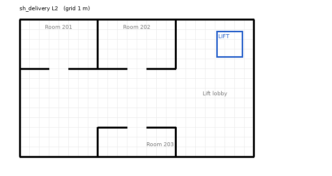

# tb3_rmf_sh — Open-RMF 군집 관제 실습 환경 (2층 건물 · 엘리베이터 · 로봇 2대)

Ubuntu 24.04 + ROS 2 Jazzy + Open-RMF에서 돌아가는 **배달 실습용 가상 건물**이다.
1층에서 물건을 싣고 **엘리베이터를 타고 2층 방으로 배달**하는 작업을 로봇 2대에게 나눠 시킬 수 있다.

| 1층 (L1) | 2층 (L2) |
|---|---|
|  |  |

- 주황 점 = 이름 있는 지점, 하늘색 선 = 로봇이 다니는 경로(lane), 파란 네모 = 엘리베이터, 회색 격자 1칸 = 1 m

| 항목 | 값 |
|---|---|
| 건물 이름 | `sh_delivery` (24 m × 14 m, 2개 층, 2층 높이 4 m) |
| 엘리베이터 | `sh_lift` 1대 (2.7 m × 2.7 m, 1층 ↔ 2층) |
| 로봇 | `tinyRobot1`, `tinyRobot2` — fleet 이름 `sh_tinyRobot`, 1층 충전실에서 시작 |
| 물건 싣는 곳 | `sh_pickup` (1층 물류실) — 디스펜서 `sh_dispenser`, `sh_dispenser_2` (각각 콜라 1개) |
| 배달 받는 곳 | `room_201`, `room_202`, `room_203` (2층) — 받는 장치 `sh_ingestor_201/202/203` |
| 실행 | `ros2 launch tb3_rmf_sh_gz sh_delivery.launch.xml` |

---

## 1. 패키지 구성

```
tb3_rmf_sh/
├── LICENSE                    Apache License 2.0
├── README.md
├── tb3_rmf_sh_maps/           건물 지도 (빌드할 때 Gazebo 월드 + RMF 경로망이 생성됨)
│   └── maps/sh_delivery/
│       ├── sh_delivery.building.yaml   벽 · 층 · 엘리베이터 · 경로 · 로봇 위치
│       ├── sh_delivery_L1.png          1층 평면도 (traffic-editor 배경)
│       └── sh_delivery_L2.png          2층 평면도
├── tb3_rmf_sh_demos/          RMF 실행 설정
│   ├── launch/sh_delivery.launch.xml               RMF 핵심 + fleet adapter
│   └── config/sh_delivery/sh_tinyRobot_config.yaml 로봇 무리 설정
└── tb3_rmf_sh_gz/             Gazebo 시뮬레이션 실행
    └── launch/
        ├── sh_delivery.launch.xml      ★ 이것 하나로 전부 실행
        └── sh_simulation.launch.xml    Gazebo + /clock 브리지
```

| 패키지 | 하는 일 | 의존 |
|---|---|---|
| `tb3_rmf_sh_maps` | `.building.yaml` → Gazebo 월드(`.world`) · 경로망(`nav_graphs/0.yaml`) 생성 | `rmf_building_map_tools`, `rmf_demos_assets` |
| `tb3_rmf_sh_demos` | 교통 스케줄 · 지도 서버 · 엘리베이터 관리 · 작업 배분 · fleet adapter 실행 | `rmf_demos`, `rmf_demos_fleet_adapter`, `rmf_demos_tasks` |
| `tb3_rmf_sh_gz` | Gazebo에 건물 · 로봇 · 엘리베이터를 띄움 | `rmf_robot_sim_gz_plugins`, `rmf_building_sim_gz_plugins`, `ros_gz_bridge` |

로봇 모델(TinyRobot), fleet adapter, 작업 명령(`dispatch_*`)은 **공식 Open-RMF `rmf_demos`의 것을 그대로** 쓴다. 이 저장소에는 **우리 건물과 설정만** 들어 있다. 그래서 공식 `rmf_demos`가 업데이트돼도 충돌하지 않는다.

---

## 2. 준비 (처음 한 번)

필요한 것: Ubuntu 24.04, ROS 2 Jazzy, Open-RMF(`ros-jazzy-rmf-dev`), `~/rmf_ws/src` 안의 `rmf_demos` 소스.
Open-RMF 실습 환경을 이미 설치해 `~/rmf_ws`가 빌드되어 있다면 **3장으로 바로 간다.**

새로 설치하는 경우:

```bash
sudo apt update && sudo apt install -y ros-jazzy-rmf-dev
mkdir -p ~/rmf_ws/src
cd ~/rmf_ws/src
git clone https://github.com/open-rmf/rmf_demos.git -b jazzy
```

**명령어 풀이**
- `sudo apt update`: **s**uper**u**ser **do** + **A**dvanced **P**ackage **T**ool. 저장소의 패키지 목록을 새로 받는다
- `&&`: 앞 명령이 성공했을 때만 뒤 명령을 실행
- `apt install -y ros-jazzy-rmf-dev`: Open-RMF 핵심 패키지 묶음(메타패키지) 설치. `-y` = **y**es, 확인 질문에 자동 동의
- `mkdir -p`: **m**a**k**e **dir**ectory. `-p` = **p**arents, 중간 폴더까지 만들고 이미 있어도 오류 없음
- `git clone 주소 -b jazzy`: 저장소를 내려받는다. `-b` = **b**ranch. ROS 2 Jazzy용 브랜치를 받는다

---

## 3. 이 저장소 받기 · 빌드

```bash
cd ~/rmf_ws/src
git clone https://github.com/<내 GitHub 아이디>/tb3_rmf_sh.git
cd ~/rmf_ws
rosdep install --from-paths src --ignore-src -ry
colcon build --symlink-install --packages-up-to tb3_rmf_sh_gz
source ~/rmf_ws/install/setup.bash
```

**명령어 풀이**
- `cd ~/rmf_ws/src`: **c**hange **d**irectory. 워크스페이스의 소스 폴더로 이동. `rmf_demos`와 **같은 폴더**에 받는다
- `rosdep install`: 소스 패키지들이 필요로 하는 apt 패키지를 찾아 설치
  - `--from-paths src`: `src` 아래 모든 패키지의 `package.xml`을 읽는다
  - `--ignore-src`: `src`에 소스로 있는 패키지(`rmf_demos` 등)는 apt로 깔지 않는다
  - `-r`: 하나가 실패해도 계속(**r**esume), `-y`: 자동 동의(**y**es)
- `colcon build`: **col**lective **con**struction. 워크스페이스의 패키지를 빌드
  - `--symlink-install`: 설치 폴더에 설정 파일을 복사하지 않고 **링크**한다. `config/` · `launch/` 수정 후 다시 빌드하지 않아도 반영된다 (지도 `.building.yaml`은 예외 — 5장)
  - `--packages-up-to tb3_rmf_sh_gz`: `tb3_rmf_sh_gz`와 **그것이 의존하는 패키지까지만** 빌드 (이미 빌드된 것은 빠르게 지나간다)
- `source ~/rmf_ws/install/setup.bash`: 빌드한 패키지를 이 터미널에 등록. **새 터미널마다** 필요 (`~/.bashrc`에 넣어 두면 자동)

▶ **빌드 결과**: 마지막에 `Summary: ... packages finished` 이고 `failed`가 없어야 한다.
`tb3_rmf_sh_maps` 빌드 중 로그에 `BUILDING WORLDFILE WITH COMMAND: ros2 run rmf_building_map_tools building_map_generator gazebo ...`가 보이면 지도 → 월드 변환이 실행된 것이다.

> ⚠️ **첫 빌드는 인터넷이 필요하다.** `tb3_rmf_sh_maps`가 빌드될 때 디스펜서 · 콜라 · 받는 장치 모델을 Gazebo Fuel에서 `~/.gazebo/models`로 내려받는다(`building_map_model_downloader`).

확인:

```bash
ls ~/rmf_ws/install/tb3_rmf_sh_maps/share/tb3_rmf_sh_maps/maps/sh_delivery
```

- `ls`: **l**i**s**t. 폴더 내용 보기

▶ **결과**: `models  nav_graphs  sh_delivery.world`

---

## 4. 실행

### 4-1. 건물 · 로봇 띄우기 — 터미널 ①

```bash
source ~/rmf_ws/install/setup.bash
ros2 launch tb3_rmf_sh_gz sh_delivery.launch.xml
```

**명령어 풀이**
- `ros2 launch 패키지 파일`: launch 파일 하나로 여러 프로그램을 한꺼번에 실행

▶ **결과**: Gazebo 창(2층 건물, 1층 충전실에 로봇 2대, 오른쪽 위 엘리베이터)과 RViz 창(경로망 · 로봇 위치)이 뜬다.
첫 실행은 모델을 읽느라 Gazebo 창이 1~2분 검게 보일 수 있다.

| 같이 실행되는 것 | 하는 일 |
|---|---|
| `rmf_traffic_schedule` | 로봇들의 앞으로의 경로를 시간표로 모아 **겹치지 않게** 조정 |
| `building_map_server` | 건물 지도(층 · 엘리베이터 · 경로)를 다른 노드에 알려줌 |
| `lift_supervisor` · `door_supervisor` | 엘리베이터 · 문 요청을 정리 |
| `rmf_task_dispatcher` | 작업이 들어오면 **어느 로봇이 할지 입찰**로 정함 |
| `fleet_manager` · `fleet_adapter` | `sh_tinyRobot` 무리(2대)와 RMF 사이의 통역 |
| `gz sim` + `parameter_bridge` | Gazebo 시뮬레이션과 시뮬레이션 시계(`/clock`) |

### 4-2. 배달 시키기 — 터미널 ②

```bash
source ~/rmf_ws/install/setup.bash
ros2 run rmf_demos_tasks dispatch_delivery -p sh_pickup -ph sh_dispenser -d room_201 -dh sh_ingestor_201 --use_sim_time
```

**명령어 풀이**
- `ros2 run 패키지 실행파일`: 패키지 안의 프로그램 하나 실행. `dispatch_delivery` = 배달 작업 요청
- `-p sh_pickup`: **p**ickup. 물건을 싣는 장소 (경로망의 지점 이름)
- `-ph sh_dispenser`: **p**ickup **h**andler. 그 장소에서 물건을 로봇에 올려 주는 장치
- `-d room_201`: **d**ropoff. 내려놓을 장소 (2층)
- `-dh sh_ingestor_201`: **d**ropoff **h**andler. 그 장소에서 물건을 받아 가는 장치
- `--use_sim_time`: 시뮬레이션 시계 사용

▶ **결과**: 한 로봇이 입찰로 선택되어 물류실(`sh_pickup`)로 가서 콜라를 받고 → 엘리베이터 앞 → **엘리베이터를 불러 타고 2층** → `room_201`에서 내려놓는다 → 작업이 끝나면 대기 장소로 돌아간다(`finishing_request: park`).

**두 대를 동시에 일 시키기** (터미널 ②에서 이어서):

```bash
ros2 run rmf_demos_tasks dispatch_delivery -p sh_pickup -ph sh_dispenser_2 -d room_203 -dh sh_ingestor_203 --use_sim_time
```

- 두 번째 배달은 **두 번째 디스펜서**(`-ph sh_dispenser_2`)를 쓴다. 디스펜서 하나에 물건(콜라 모델)이 **1개씩**이라, 두 배달을 동시에 돌릴 때는 디스펜서를 나눠 쓴다. 받는 장치(ingestor)는 받은 물건을 잠시 뒤 원래 자리로 되돌려 놓으므로, 배달이 끝나면 같은 디스펜서를 다시 쓸 수 있다
- 어느 로봇이 맡을지는 **입찰**(가장 빨리 끝낼 수 있는 로봇)로 정해진다. 보통 놀고 있는 다른 로봇이 선택되지만, 입찰 결과에 따라 같은 로봇의 다음 작업으로 줄을 설 수도 있다. 특정 로봇에게 시키려면 `-F sh_tinyRobot -R tinyRobot2`
- 두 로봇이 같은 통로 · 엘리베이터를 쓰려 할 때 교통 스케줄이 한쪽을 기다리게 하는 것을 RViz에서 볼 수 있다

### 4-3. 순찰 · 이동 시키기

```bash
ros2 run rmf_demos_tasks dispatch_patrol -p room_201 room_202 room_203 -n 2 --use_sim_time
ros2 run rmf_demos_tasks dispatch_go_to_place -p L2_hall_center --use_sim_time
```

- `dispatch_patrol`: 순찰. `-p` = **p**laces(돌 지점들), `-n` = 바퀴 수(**n**umber of rounds)
- `dispatch_go_to_place`: 한 지점으로 이동. `-p` = **p**lace
- 특정 로봇을 지정하려면 `-F sh_tinyRobot -R tinyRobot2` (`-F` = **F**leet, `-R` = **R**obot)

### 4-4. 지점 이름 목록

| 층 | 이름 | 용도 |
|---|---|---|
| L1 | `tinyRobot1_charger`, `tinyRobot2_charger` | 충전 · 시작 위치 |
| L1 | `sh_pickup` | 물건 싣는 곳 (`sh_dispenser`) |
| L1 | `L1_hall_west`, `L1_hall_center`, `L1_lift_lobby` | 복도 · 엘리베이터 앞 |
| L2 | `room_201`, `room_202`, `room_203` | 배달 받는 곳 (`sh_ingestor_201/202/203`) |
| L2 | `L2_hall_west`, `L2_hall_center`, `L2_lift_lobby` | 복도 · 엘리베이터 앞 |

### 4-5. rmf-web 대시보드와 함께

rmf-web(api-server, dashboard)을 먼저 띄운 뒤:

```bash
ros2 launch tb3_rmf_sh_gz sh_delivery.launch.xml server_uri:="ws://localhost:8000/_internal"
```

- `server_uri:=...`: fleet adapter와 작업 배분 노드가 로봇 · 작업 상태를 rmf-web api-server로 보낸다. 대시보드에서 로봇 2대와 작업 진행이 보이고, 화면에서 작업을 만들 수 있다

### 4-6. 끄기

각 터미널에서 `Ctrl` + `C`.

---

## 5. 지도 고치기

1. `traffic-editor`(Open-RMF 지도 편집기)로 연다
   ```bash
   traffic-editor ~/rmf_ws/src/tb3_rmf_sh/tb3_rmf_sh_maps/maps/sh_delivery/sh_delivery.building.yaml
   ```
2. 벽 · 지점 · 경로(lane) · 모델을 고치고 저장
3. **다시 빌드해야 반영된다.** 월드와 경로망은 빌드할 때 생성되기 때문이다
   ```bash
   cd ~/rmf_ws
   colcon build --symlink-install --packages-select tb3_rmf_sh_maps
   ```
   - `--packages-select`: 지정한 패키지 **하나만** 빌드

| 지도 규칙 | 이유 |
|---|---|
| 로봇 시작 지점에는 `spawn_robot_name` · `spawn_robot_type` · `is_charger` | Gazebo에 로봇이 생기고, RMF가 충전 장소로 안다 |
| `spawn_robot_name`은 `sh_tinyRobot_config.yaml`의 `robots:` 이름과 같게 | fleet adapter가 이 이름으로 로봇을 찾는다 |
| 엘리베이터 안 지점에는 `lift_cabin: sh_lift` | 이 지점을 통해 층과 층이 이어진다 |
| 싣는 곳에 `pickup_dispenser`, 내리는 곳에 `dropoff_ingestor` | 배달 작업의 `-ph` · `-dh` 이름과 같은 장치 모델이 그 근처(1 m 안)에 있어야 한다 |
| 지점 이름은 건물 전체에서 겹치지 않게 | 작업 명령이 이름으로 장소를 찾는다 |

---

## 6. 안 될 때

| 증상 | 확인 |
|---|---|
| `Package 'tb3_rmf_sh_gz' not found` | `source ~/rmf_ws/install/setup.bash`를 했는지, 빌드가 성공했는지 |
| `tb3_rmf_sh_maps` 빌드 실패, 로그에 `numpy.core.multiarray failed to import` 또는 `3-dimensional vectors` | numpy 2.x가 깔려 있다. Ubuntu 24.04 기본 numpy(1.26.4)로 되돌린 뒤 `rm -rf build/tb3_rmf_sh_maps` 후 다시 빌드 |
| Gazebo에 디스펜서 · 콜라가 안 보임 | 첫 빌드 때 인터넷이 없어 모델을 못 받았다. 인터넷 연결 후 `rm -rf build/tb3_rmf_sh_maps` → 다시 빌드 |
| 배달 명령 후 아무 로봇도 안 움직임 | 터미널 ①에 fleet adapter 오류가 없는지, 명령에 `--use_sim_time`을 붙였는지 |
| 로봇이 엘리베이터 앞에서 멈춤 | 터미널 ①에 `lift_supervisor` 관련 오류가 없는지. Gazebo에서 엘리베이터 문이 열리는지 |
| `Address already in use` (포트 22011) | 다른 RMF 데모가 이미 켜져 있다. 그쪽을 끄고 다시 실행 |

---

## 7. 라이선스와 출처

- 이 저장소: Apache License 2.0 (`LICENSE`)
- 건물(`sh_delivery.building.yaml`)과 평면도 PNG는 이 저장소에서 새로 만든 것이다
- 아래 파일은 [open-rmf/rmf_demos](https://github.com/open-rmf/rmf_demos) (Apache License 2.0)의 파일을 바탕으로 이름 · 경로를 바꾼 것이다
  - `tb3_rmf_sh_maps/CMakeLists.txt` ← `rmf_demos_maps/CMakeLists.txt`
  - `tb3_rmf_sh_demos/config/sh_delivery/sh_tinyRobot_config.yaml` ← `rmf_demos/config/office/tinyRobot_config.yaml`
  - `tb3_rmf_sh_gz/launch/sh_simulation.launch.xml` ← `rmf_demos_gz/launch/simulation.launch.xml`
- 실행 시 쓰는 로봇 모델 · fleet adapter · 작업 명령은 Open-RMF 공식 패키지(`rmf_demos_assets`, `rmf_demos_fleet_adapter`, `rmf_demos_tasks`)다

---

## 8. 검증 기록

| 항목 | 방법 | 결과 |
|---|---|---|
| 지도 → 월드 · 경로망 생성 | Open-RMF `rmf_building_map_tools`(jazzy 브랜치 소스)의 `building_map_generator gazebo` / `nav` 실행 | `sh_delivery.world`, `nav_graphs/0.yaml` 생성 ✅ |
| 층 연결 | 생성된 `0.yaml`에서 두 충전소부터 경로를 따라가며 확인 (엘리베이터 지점으로 L1↔L2 연결) | 22개 지점 전부 도달 가능 ✅, 지점 이름 중복 없음 ✅ |
| 월드 내용 | 생성된 `.world` 확인 | 로봇 2대(L1 충전소), 엘리베이터 `sh_lift`(문은 L1 · L2 모두 복도 쪽), 디스펜서 2개 + 콜라 2개, 받는 장치 3개(L2) ✅ |
| 빌드 | `colcon build --packages-up-to tb3_rmf_sh_gz` (지도 도구는 같은 소스로 대체) | 3개 패키지 빌드, launch가 가리키는 설치 경로의 파일이 모두 존재 ✅ |
| launch 파일 문법 | ROS 2 launch XML 파서로 읽기, `--show-args` | 통과 ✅ |
| **Gazebo · RMF 실제 실행** | — | **작성 환경에서 Open-RMF 전체를 설치할 수 없어 미실행.** Open-RMF가 설치된 PC에서 4장 순서로 확인한다 |
